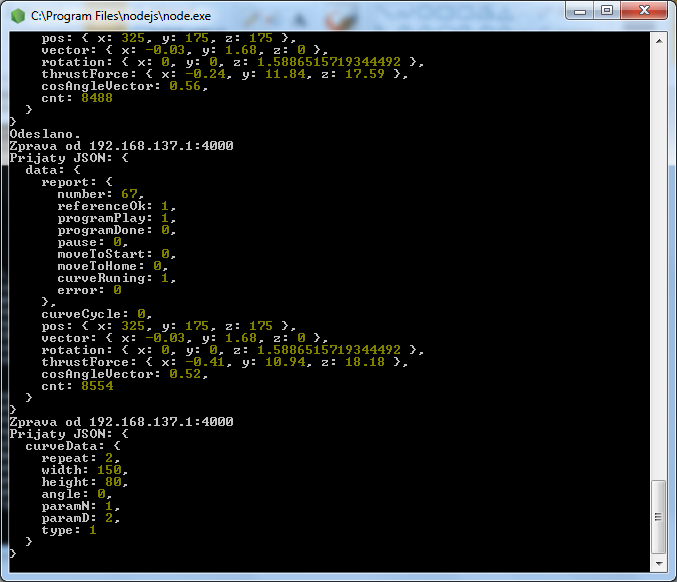

# Ctyrmotorak_VR
Ukázkový program pro komunikaci s "čtyřmotorákem".
# Popis komunikace
Programy mezi sebou komunikují protokolem UDP přes port 4000. Pro získání dat ze serveru stačí odeslat `{"get": "data"}`, pro získání parametrů křivky se odesílá `{"get": "curve"}`. Na následujícím screenshotu jsou vidět oba typy přijatých dat. 

## Popisy proměnných
### data
- report: stav programu
- curveCycle: počet cyklů (desetinné číslo, ukazuje i zlomky cyklů)
- pos: poloha ruky
- vector: vektor směru pohybu
- rotation: rotace ruky
- thrustForce: síla ruky
- cosAngleVector: směrový úhel
- cnt: počítadlo odeslaných zpráv
### curveData
- repeat: počet opakování
- width, height: šířka a výška křivky
- angle: úhel náklonu křivky (v radiánech)
- paramN, paramD: parametry pro růži (7. typ křivky)
- typ: typ křivky (1 - elipsa, 2 - lemniskáta, 3 - obdélník, 4 - nefroid, 5 - kardioid, 6 - spirála, 7 - růže)
